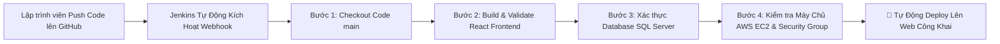

# 🌍 GoTravel - Nền Tảng Đặt Tour & Vé Du Lịch Trực Tuyến Tích Hợp AI

[](Jenkinsfile)
[](http://ec2-54-252-154-78.ap-southeast-2.compute.amazonaws.com/)
[](https://appreciate-rpg-zoloft-intermediate.trycloudflare.com/)
[](GoTravel.API/)
[](travel-ticket-frontend/)
[](GoTravel_Full_Database_Init.sql)

> **GoTravel** là hệ sinh thái thương mại điện tử du lịch toàn diện thế hệ mới, cho phép khách hàng tìm kiếm, đặt tour, mua vé vui chơi giải trí (E-ticket QR), nhận tư vấn du lịch tự động qua **Trợ lý AI thông minh**, cùng hệ thống quản trị **Admin 35+ module nghiệp vụ** vận hành theo kiến trúc Full-stack hiện đại.

---

## 🌐 1. ĐƯỜNG DẪN TRUY CẬP TRỰC TUYẾN (PUBLIC LIVE DEMO)

Hệ thống đã được đóng gói container hóa và xuất bản công khai trên Internet:

| Môi Trường / Kênh Truy Cập | Địa Chỉ URL Trực Tuyến | Ghi Chú |
| :--- | :--- | :--- |
| 🌟 **Link Web Trực Tuyến (Cloudflare HTTPS)** | [**https://appreciate-rpg-zoloft-intermediate.trycloudflare.com/**](https://appreciate-rpg-zoloft-intermediate.trycloudflare.com/) | Kết nối bảo mật SSL công khai |
| ☁️ **Máy Chủ AWS EC2 (Sydney)** | [**http://ec2-54-252-154-78.ap-southeast-2.compute.amazonaws.com/**](http://ec2-54-252-154-78.ap-southeast-2.compute.amazonaws.com/) | Máy chủ đám mây AWS EC2 |
| 🚀 **IP Trực Tiếp Máy Chủ AWS** | [**http://54.252.154.78/**](http://54.252.154.78/) | Public IP Port 80 |
| 🛡️ **Trang Quản Trị Hệ Thống (Admin)** | [**Truy cập Admin Portal**](https://appreciate-rpg-zoloft-intermediate.trycloudflare.com/admin) | Quản trị toàn diện 35+ module |
| 🤖 **Quy Trình Tự Động CI/CD Jenkins** | [**Xem Jenkinsfile cấu hình**](Jenkinsfile) | Pipeline build, test & deploy tự động |

---

## 🚀 2. TỔNG HỢP TOÀN BỘ CHỨC NĂNG HỆ THỐNG (GHI HẾT 100%)

### 👤 A. Phân Hệ Du Khách (Customer Frontend Portal)
1. **Trang Chủ Hiện Đại (Travel Discovery Portal):**
   - Hero banner động kèm bộ tìm kiếm thông minh theo điểm đến, ngày đi, mức giá.
   - Danh mục tour nổi bật, tour giờ chót, khuyến mãi flash sale đếm ngược thời gian thực.
   - Chế độ giao diện kép: **Sáng / Tối (Light & Dark Mode)** chuyển đổi mượt mà.
2. **Đặt Tour Du Lịch Trọn Gói:**
   - Khám phá tour theo vùng miền: Bắc, Trung, Nam, Tây Nguyên, Tour Du thuyền 5 sao, Tour Quốc tế.
   - Chi tiết lịch trình theo từng ngày, chính sách giá vé người lớn / trẻ em / em bé.
   - Chọn ngày khởi hành thực tế, số chỗ còn trống trực tiếp từ Database SQL Server.
3. **Đặt Vé Vui Chơi & Điểm Tham Quan (Attractions & E-Tickets):**
   - Đặt vé các công viên giải trí hàng đầu: Sun World Bà Nà Hills, VinWonders Phú Quốc, Cáp treo Hòn Thơm,...
   - Xuất vé điện tử **E-Ticket kèm mã QR Code bảo mật** — quét mã trực tiếp vào cổng, không cần xếp hàng đổi vé giấy.
4. **Trợ Lý Du Lịch Thông Minh AI (AI Travel Assistant):**
   - Tích hợp cửa sổ chat thông minh tương tác bằng ngôn ngữ tự nhiên.
   - Khả năng tính toán toán học chính xác (`1 + 1 = 2`), phân tích chi phí chuyến đi.
   - Tư vấn điểm đến, khách sạn, ẩm thực, lịch trình du lịch cá nhân hóa.
   - Lưu trữ toàn bộ lịch sử hội thoại của từng phiên vào CSDL SQL Server.
5. **AI Lập Kế Hoạch Chuyến Đi (AI Trip Planner):**
   - Tự động thiết kế lịch trình du lịch thông minh dựa trên số ngày, điểm đến, ngân sách và sở thích.
6. **Cẩm Nang & Bài Viết Du Lịch Chuẩn iVIVU:**
   - Kho bài viết review kinh nghiệm du lịch phong phú, hình ảnh chất lượng cao, chia sẻ ẩm thực và địa điểm check-in hấp dẫn.
7. **Hệ Thống Đánh Giá 5 Sao & Bình Luận Đa Chiều:**
   - Du khách đánh giá xếp hạng sao, nhận xét trải nghiệm, gửi hình ảnh thực tế.
   - Đội ngũ Chăm Sóc Khách Hàng (CSKH) phản hồi chính thức ngay dưới bình luận.
8. **Giỏ Hàng & Cổng Thanh Toán Đa Kênh:**
   - Hỗ trợ thanh toán VNPAY, MoMo, ZaloPay, Thẻ ATM/Visa/MasterCard nội địa & quốc tế.
   - Chuyển khoản ngân hàng tự động hiển thị mã QR kèm mã đơn hàng.
9. **Chương Trình Hội Viên & Điểm Thưởng (GoPoints & Membership):**
   - Tích lũy điểm thưởng theo giá trị đơn hàng, nâng hạng thẻ: Silver, Gold, Platinum, Diamond.

---

### 🛡️ B. Phân Hệ Quản Trị Hệ Thống (Admin Management - 35+ Modules Hoàn Chỉnh)
Toàn bộ 35+ module quản trị đã được xây dựng hoàn thiện 100%, không còn bất kỳ module placeholder hay huy hiệu "SOON" nào:

#### 1. Bảng Điều Khiển Tổng Quan (Dashboard)
- Thống kê doanh thu theo ngày/tháng/năm, số lượng tour đã đặt, lượt khách tham quan.
- Biểu đồ tăng trưởng trực quan, danh sách đơn hàng mới cần xử lý.

#### 2. Nhóm Quản Trị Tour Du Lịch (7 Modules)
- **Tour Management (`/admin/tours`):** Quản lý toàn bộ tour, giá bán, thời lượng, hình ảnh.
- **Danh Mục Tour (`/admin/tour-categories`):** Phân loại tour biển đảo, văn hóa di sản, trekking, nghỉ dưỡng.
- **Điểm Đến (`/admin/destinations`):** Quản lý tỉnh thành, tọa độ bản đồ, mô tả điểm du lịch.
- **Lịch Trình Chi Tiết (`/admin/tour-itineraries`):** Lịch trình chi tiết ngày 1, ngày 2, điểm ăn uống, nghỉ ngơi.
- **Lịch Khởi Hành (`/admin/tour-departures`):** Ngày đi, ngày về, giá vé người lớn/trẻ em, số lượng ghế tối đa.
- **Kho Chỗ Tour (`/admin/tour-inventory`):** Theo dõi chỗ còn trống, chỗ đã giữ, chỗ thanh toán thành công.
- **Hướng Dẫn Viên Tour (`/admin/tour-guides`):** Phân công HDV dẫn đoàn cho từng tour cụ thể.

#### 3. Nhóm Quản Trị Vé Vui Chơi & Điểm Tham Quan (6 Modules)
- **Địa Điểm Vui Chơi (`/admin/attractions`):** Quản lý công viên giải trí, thủy cung, cáp treo.
- **Sản Phẩm Vé (`/admin/products`):** Danh mục sản phẩm vé vui chơi mở bán.
- **Loại Vé (`/admin/ticket-types`):** Vé người lớn, vé trẻ em, vé người cao tuổi, vé combo kèm buffet.
- **Kho Vé Barcode/QR (`/admin/inventory`):** Quản lý kho mã QR điện tử, ngày hết hạn.
- **QR Check-in (`/admin/checkin`):** Máy quét mã QR soát vé tại cổng theo thời gian thực.
- **Quản Lý Vé Đã Bán (`/admin/tickets`):** Danh sách vé điện tử đã phát hành, trạng thái sử dụng.

#### 4. Nhóm Quản Trị Booking & Thu Chi (5 Modules)
- **Tour Booking (`/admin/tour-bookings`):** Đơn đặt tour của khách, thông tin liên hệ, danh sách đoàn.
- **Ticket Booking (`/admin/bookings`):** Đơn đặt vé vui chơi, ngày sử dụng, trạng thái vé.
- **Thanh Toán (`/admin/payments`):** Lịch sử giao dịch thanh toán qua cổng VNPAY, MoMo, Ngân hàng.
- **Hoàn Tiền (`/admin/refunds`):** Tiếp nhận yêu cầu hoàn hủy vé/tour, tính phí hủy và duyệt hoàn tiền.
- **Danh Sách Chờ (`/admin/waitlist`):** Danh sách khách chờ giữ chỗ khi tour hết chỗ.

#### 5. Nhóm Quản Trị AI Chatbot (6 Modules)
- **AI Settings (`/admin/ai-settings`):** Cấu hình tính cách bot, prompt hệ thống, model ngôn ngữ.
- **AI Trip Planner Admin (`/admin/ai-trip-planner`):** Quản lý các mẫu lịch trình do AI sinh ra.
- **Lịch Sử Chat (`/admin/ai-chat`):** Xem lại toàn bộ cuộc hội thoại giữa du khách và AI Chatbot.
- **Knowledge Base (`/admin/ai-knowledge`):** Kho tri thức du lịch nạp vào cho AI học dữ liệu tour.
- **Feedback AI (`/admin/ai-feedback`):** Đánh giá độ hài lòng của khách hàng về câu trả lời của AI.
- **Thống Kê AI (`/admin/ai-stats`):** Biểu đồ tần suất hỏi, chủ đề được quan tâm nhiều nhất.

#### 6. Nhóm Quản Trị Marketing & Bán Hàng (6 Modules)
- **Voucher Khuyến Mãi (`/admin/vouchers`):** Tạo mã giảm giá theo %, số tiền cố định, số lượt dùng.
- **Flash Sale (`/admin/flash-sales`):** Cài đặt khung giờ vàng giảm giá sốc kèm đếm ngược.
- **Combo Tiết Kiệm (`/admin/combos`):** Tạo gói combo Tour + Khách sạn + Vé vui chơi.
- **Quản Lý Banner (`/admin/banners`):** Thay đổi hình ảnh slider quảng cáo ngoài trang chủ.
- **Hội Viên Thân Thiết (`/admin/membership`):** Chính sách điểm thưởng, đặc quyền theo từng hạng thẻ.
- **Chương Trình Giới Thiệu Khách (`/admin/referral`):** Quản lý mã affiliate, tỷ lệ hoa hồng, số tiền chi trả đối tác.

#### 7. Nhóm Quản Trị Người Dùng & Nhân Sự (4 Modules)
- **Quản Lý Khách Hàng (`/admin/customers`):** Hồ sơ khách hàng, lịch sử đặt vé, tổng chi tiêu.
- **Quản Lý Nhân Viên (`/admin/staff`):** Danh sách nhân viên, phòng ban, phân quyền tài khoản làm việc.
- **Quản Lý Đối Tác B2B (`/admin/partners`):** Hãng xe, hãng hàng không, resort, khu vui chơi, mức chiết khấu.
- **Hồ Sơ Hướng Dẫn Viên (`/admin/tour-guides-users`):** Thẻ HDV quốc tế/nội địa, danh sách ngoại ngữ, kinh nghiệm, trạng thái sẵn sàng nhận tour hoặc đang dẫn tour.

#### 8. Nhóm Quản Trị Nội Dung (4 Modules)
- **Đánh Giá Du Khách (`/admin/reviews`):** Duyệt đánh giá sao, ẩn/hiện bình luận, phản hồi chính thức từ CSKH.
- **Hỏi Đáp Du Khách (`/admin/qna`):** Tiếp nhận câu hỏi du khách, công cụ gợi ý trả lời tự động từ AI, duyệt đăng lên website.
- **Cẩm Nang Du Lịch Blog (`/admin/blog`):** Soạn thảo bài viết, tải hình ảnh, xuất bản bài viết cẩm nang.
- **Câu Hỏi Thường Gặp (`/admin/faq`):** Quản lý câu hỏi thường gặp dạng accordion, sắp xếp thứ tự hiển thị.

#### 9. Nhóm Hỗ Trợ Khách Hàng (2 Modules)
- **Phiếu Hỗ Trợ (`/admin/support-tickets`):** Quản lý yêu cầu khiếu nại, sự cố của khách, phân công người xử lý.
- **Hộp Thư Trực Tuyến Live Chat (`/admin/live-chat`):** Giao diện chat thời gian thực 2 cột, xem trang khách đang duyệt, câu trả lời mẫu nhanh.

#### 10. Nhóm Quản Trị Hệ Thống (4 Modules)
- **Báo Cáo Phân Tích (`/admin/reports`):** Báo cáo doanh thu, lượng khách, lợi nhuận chi tiết.
- **Phân Quyền Vai Trò (`/admin/roles`):** Ma trận quyền hạn CRUD (Xem, Thêm, Sửa, Xóa, Xuất file) cho Super Admin, Điều hành tour, Kế toán, CSKH.
- **Nhật Ký Hoạt Động (`/admin/activity-logs`):** Ghi lại toàn bộ lịch sử thao tác của quản trị viên trên hệ thống.
- **Cài Đặt Hệ Thống (`/admin/settings`):** Cấu hình email thông báo, cổng thanh toán, hotline, thông tin công ty.

---

## 🗄️ 3. KIẾN TRÚC CƠ SỞ DỮ LIỆU SQL SERVER

Hệ thống sử dụng **Microsoft SQL Server 2025** với CSDL `GoTravelDB` gồm **23 bảng dữ liệu chuẩn hóa**:

```
GoTravelDB
 ├── __EFMigrationsHistory     (Lịch sử phiên bản CSDL EF Core)
 ├── Roles                     (Phân quyền vai trò người dùng)
 ├── Users                     (Tài khoản quản trị viên & du khách)
 ├── Destinations              (Điểm đến du lịch Việt Nam)
 ├── Tours                     (Thông tin chi tiết các tour du lịch)
 ├── TourCategory              (Danh mục phân loại tour)
 ├── TourDepartures            (Lịch khởi hành thực tế kèm số ghế)
 ├── TourDestination           (Bảng liên kết Tour - Điểm đến nhiều-nhiều)
 ├── TourGuide                 (Đội ngũ hướng dẫn viên du lịch)
 ├── TourGuideAssignment       (Lịch phân công hướng dẫn viên dẫn đoàn)
 ├── TourHighlight             (Điểm nhấn nổi bật của từng tour)
 ├── TourImage                 (Thư viện hình ảnh tour chất lượng cao)
 ├── TourInventory             (Quản lý kho chỗ, ghế trống)
 ├── TourItinerary             (Lịch trình tour chi tiết từng ngày)
 ├── TourPartner               (Nhà cung cấp dịch vụ, đối tác liên kết)
 ├── TourPrice                 (Bảng giá theo từng thời điểm mùa cao điểm)
 ├── TourHomeSection           (Cấu hình các khối hiển thị trang chủ)
 ├── TourHomeSectionItem       (Các mục trong khối trang chủ)
 ├── Bookings                  (Đơn đặt vé và đặt tour của khách)
 ├── Vouchers                  (Mã giảm giá khuyến mãi)
 ├── ChatConversations         (Phiên trò chuyện của du khách với AI)
 └── ChatMessages              (Nội dung từng câu hỏi/đáp của AI Chatbot)
```

### 🛠️ Bộ API Quản Trị Database & Script Kiểm Tra:
- **API Status:** `GET http://localhost:5106/api/database/status` (Phản hồi trong 1ms).
- **API Query SQL:** `POST http://localhost:5106/api/database/query` (Chạy lệnh SELECT an toàn).
- **API Seed Data:** `POST http://localhost:5106/api/database/seed` (Nạp dữ liệu mẫu tức thì).
- **Kịch bản SQL đầy đủ:** [GoTravel_Full_Database_Init.sql](GoTravel_Full_Database_Init.sql)
- **Script kiểm tra tự động 5 bước qua PowerShell:** [KiemTra_Database_SQL.ps1](KiemTra_Database_SQL.ps1)

Chạy kiểm tra ngay trong PowerShell:
```powershell
powershell -ExecutionPolicy Bypass -File .\KiemTra_Database_SQL.ps1
```

---

## ⚙️ 4. KIẾN TRÚC CI/CD VỚI JENKINS & DOCKER

Dự án được cấu hình quy trình **Tự động hóa CI/CD (Continuous Integration / Continuous Deployment)** hoàn chỉnh qua [Jenkinsfile](Jenkinsfile):



### Các bước trong Jenkins Pipeline:
1. **1. Checkout Code:** Kéo mã nguồn mới nhất từ nhánh `main` của repository GitHub.
2. **2. Build Frontend React:** Cài đặt dependencies và chạy `npm run build` (kiểm tra độ tương thích 100% không lỗi).
3. **3. Validate Database:** Xác thực bộ dữ liệu lớn trên SQL Server (`GoTravelDB`), đảm bảo cấu trúc 23 bảng sẵn sàng.
4. **4. Verify AWS EC2 & Security Group:** Kiểm tra phản hồi HTTP từ IP AWS EC2 (`54.252.154.78`) và tên miền công khai.
5. **Post-Action:** Báo cáo trạng thái thành công lên giao diện quản trị Jenkins và xuất bản link website.

---

## 💻 5. HƯỚNG DẪN CHẠY DỰ ÁN CỤC BỘ (LOCAL SETUP)

### Yêu Cầu Môi Trường:
- **Node.js** >= 18.x
- **.NET SDK** >= 10.0
- **Microsoft SQL Server** (2019/2022/2025 hoặc LocalDB)

### 1. Khởi động Backend Web API (.NET 10.0):
```bash
cd GoTravel.API
dotnet restore
dotnet run
# Backend lắng nghe tại: http://localhost:5106
```

### 2. Khởi động Frontend Client & Admin (React + Vite):
```bash
cd travel-ticket-frontend
npm install
npm run dev -- --host 0.0.0.0
# Frontend lắng nghe tại: http://localhost:5173
```

### 3. Tài Khoản Quản Trị Trải Nghiệm Mẫu:
- **URL Admin:** `http://localhost:5173/admin` (hoặc qua link Cloudflare / AWS công khai)
- **Email:** `admin@gotravel.vn`
- **Mật khẩu:** `Admin@123`

---

## 👨‍💻 Tác Giả & Bản Quyền
- **Dự án:** Hệ thống đặt vé và tour du lịch GoTravel tích hợp AI Chatbot
- **Repository GitHub:** [https://github.com/LUANVANSADBOY78/web-du-lich](https://github.com/LUANVANSADBOY78/web-du-lich)
- **Bản quyền:** © 2026 GoTravel. All rights reserved.
